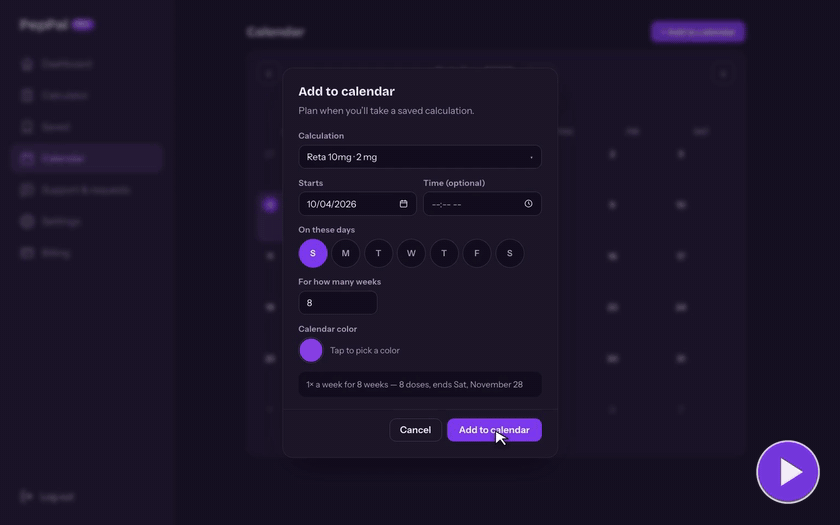

<picture>
  <source media="(prefers-color-scheme: dark)" srcset="./assets/header-dark.svg">
  <source media="(prefers-color-scheme: light)" srcset="./assets/header-light.svg">
  
</picture>

Software Engineer at Realtor.com focused on TypeScript, JavaScript, full-stack applications, APIs, and reliable production systems. I also build and operate revenue-generating web products, working across the frontend, backend, payments, and deployment.

[Open PepPal](https://app.peppal.app/) · [Watch the product demo](https://app.peppal.app/#demo) · [Peptide Dosing Protocols](https://www.peptidedosingprotocols.com/)

  
  
  
  
  
  
  
  
  
  

## What I work on

- **Production systems:** Key contributor to Realtor.com's CloudFront and Lambda@Edge router, with work spanning production changes, observability, and service migrations.
- **Developer tooling:** Led development of all five versions of the TypeScript/NestJS Starter App and developer-portal template, standardizing microservice creation and deployment across 48 repositories, including 19 production services used by 13 teams.
- **Full-stack products:** Built the PepPal React/TypeScript application and NestJS/PostgreSQL backend, alongside Next.js marketing websites for PepPal and Peptide Dosing Protocols.

## Selected products

### [PepPal](https://app.peppal.app/) · Full-stack application

A production application for saved calculations, calendar-based tracking, and subscription features.

<a href="https://app.peppal.app/#demo">
  <picture>
    <source media="(prefers-reduced-motion: reduce)" srcset="./assets/peppal-demo-poster.jpg">
    
  </picture>
</a>

[Watch the demo](https://app.peppal.app/#demo) · [Open the app](https://app.peppal.app/) · [Marketing website](https://www.peppal.app/)

- React, TypeScript, and Vite frontend with a NestJS API and PostgreSQL/Prisma data layer.
- Stripe subscription checkout, customer billing portal, and webhook-driven subscription updates.
- Resend transactional email, Listmonk subscriber workflows, and a separate Next.js marketing website.
- Multistage Docker build for the backend and a Docker-hosted Listmonk service.

### [Peptide Dosing Protocols](https://www.peptidedosingprotocols.com/)

A revenue-generating Next.js website with supplier-directory integrations, product discovery, and email subscriber workflows.

## Engineering case study: billing and email reliability

Across the PepPal app and website, I implemented billing and email workflows with explicit failure handling:

- **Verify incoming events:** Validate Stripe webhook signatures against the raw request body before processing checkout and subscription events.
- **Handle event ordering:** Check stored Stripe event timestamps before applying subscription updates so older events can be ignored.
- **Reduce duplicate emails:** Use Resend idempotency keys, persisted send markers, and database claims for trial-ending reminders.
- **Retry selectively:** Retry Listmonk rate-limit responses using `Retry-After` or exponential backoff. Avoid automatically retrying other failures that could duplicate an already-queued email.

## Tools I use

- **Languages:** TypeScript, JavaScript, SQL, Go, Bash
- **Applications and APIs:** Node.js, React, Next.js, NestJS, REST, GraphQL, PostgreSQL, Prisma, Jest
- **Cloud and delivery:** AWS, Docker, Kubernetes, Helm, Argo CD, CircleCI
- **Integrations and observability:** Stripe, Resend, Listmonk, Auth0, CloudWatch, New Relic, Backstage

## Public code and earlier projects

- **[NestJS API Starter](https://github.com/garretdgrant/nestjs-api-starter):** A personal API starter with Swagger documentation, health checks, Jest tests, and a multistage Docker build.
- **[DiamondDoor](https://github.com/garretdgrant/diamond_door):** An earlier full-stack learning project inspired by Glassdoor, built with React, Redux, Ruby on Rails, and PostgreSQL.

Outside of software, I enjoy working out, hiking, and the occasional pick-up basketball game.

